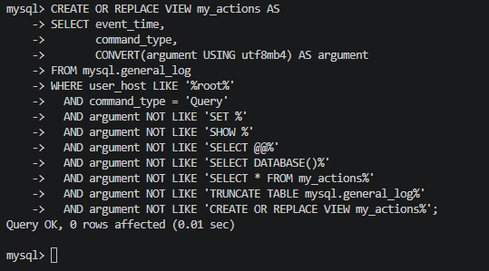
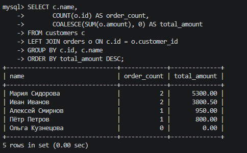
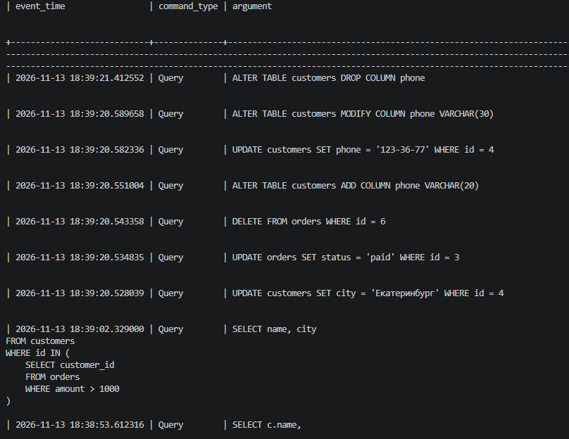
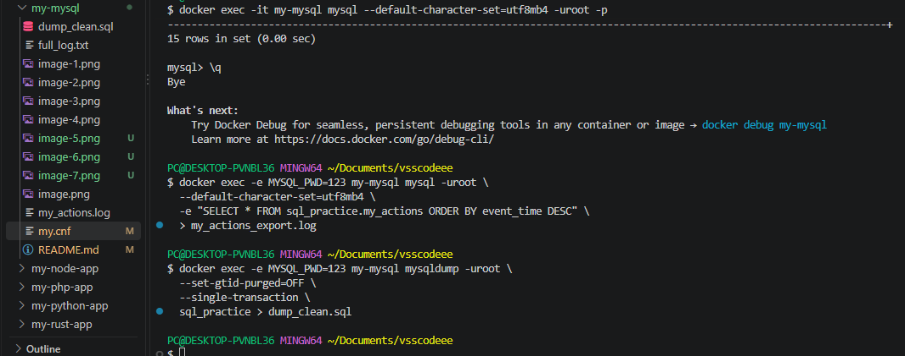
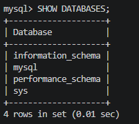
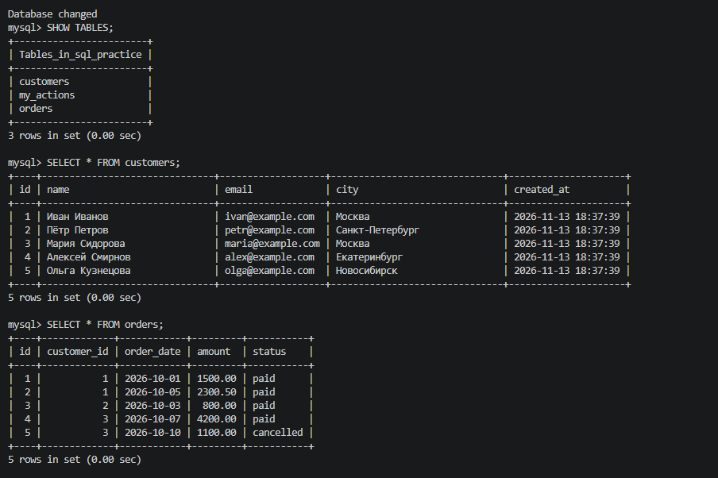
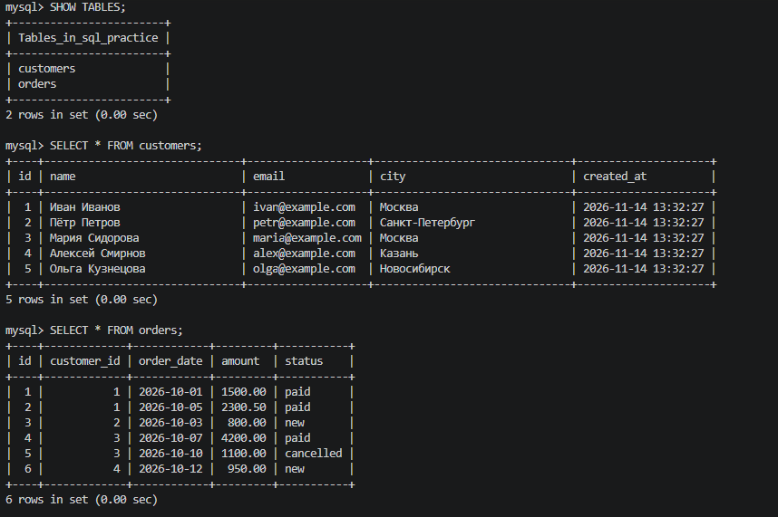
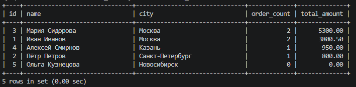
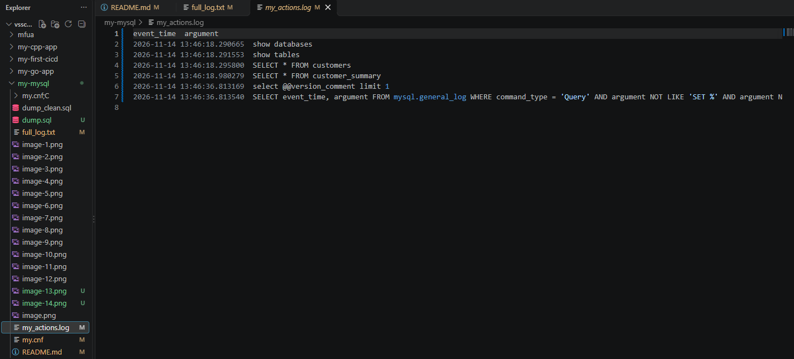

# my-mysql

# Лабораторная работа №1: Интерактивная работа с MySQL в Docker

## Цель работы
Запуск изолированного контейнера MySQL, выполнение основных операций с БД, создание дампа и выгрузка лога.

## Выполненные шаги
1. Очищены старые контейнеры и тома.

2. Контейнер запущен командой с прямым указанием параметров лога (для обхода проблемы с правами доступа к my.cnf на Windows).

3. Выполнены SQL-запросы: создание БД `my_database`, таблицы `users`, вставка, обновление и удаление данных.

4. Создан дамп базы данных (`dump_clean.sql`).

5. Выгружен лог действий (`my_actions.log`).

## Результаты
В папке проекта находятся:
- `dump_clean.sql` — резервная копия базы данных.
- `my_actions.log` — лог выполненных SQL-запросов.

## 📗 Лабораторная работа №2: Логирование в таблицу и восстановление БД

### Цель работы
Настройка логирования в таблицу (`log_output = TABLE`), создание VIEW для фильтрации логов, создание и восстановление БД из дампа.

### Ход работы
1. Запущен контейнер с новым `my.cnf`.

2. Создана БД `sql_practice` и VIEW `my_actions`.

3. Созданы таблицы `customers` и `orders`, выполнены запросы.

4. Выполнены запросы (INSERT, SELECT, JOIN, GROUP BY, UPDATE, DELETE, ALTER).

5. Сделан дамп `dump_clean.sql` и экспорт лога `my_actions_export.log`.

6. БД удалена и успешно восстановлена из дампа.

### Результаты
- Дамп базы (Lab 2): `dump_clean.sql`.
- Экспортированный лог (Lab 2): `my_actions_export.log`.

## 📙 Лабораторная работа №4: Представления (VIEW) в MySQL

### Цель работы
Изучение механизма представлений (VIEW): создание, использование, обновление, удаление, а также их влияние на производительность и безопасность.

### Ход работы
1. Настроен `my.cnf` для логирования в файл.
2. Создана БД `sql_practice` и таблицы `customers`, `orders`.
3. Создано простое VIEW `moscow_customers`.
4. Создано VIEW с JOIN и агрегацией `customer_summary`.
5. Выполнены операции UPDATE, INSERT через обновляемое VIEW.
6. Проверена работа `WITH CHECK OPTION`.
7. Создан дамп `dump.sql` и выгружен лог `my_actions.log`.

### Скриншоты (Lab 4)
#### Создание таблиц и данных

#### VIEW с JOIN и агрегацией

#### Файлы дампа и лога

