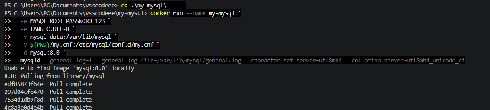
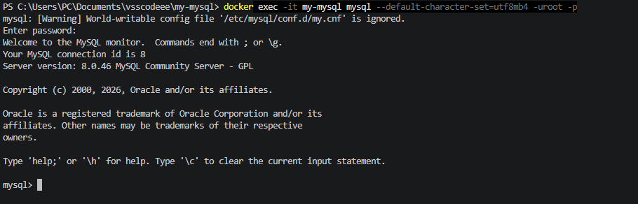
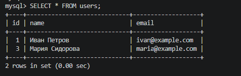
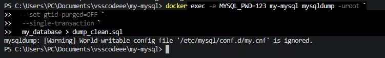
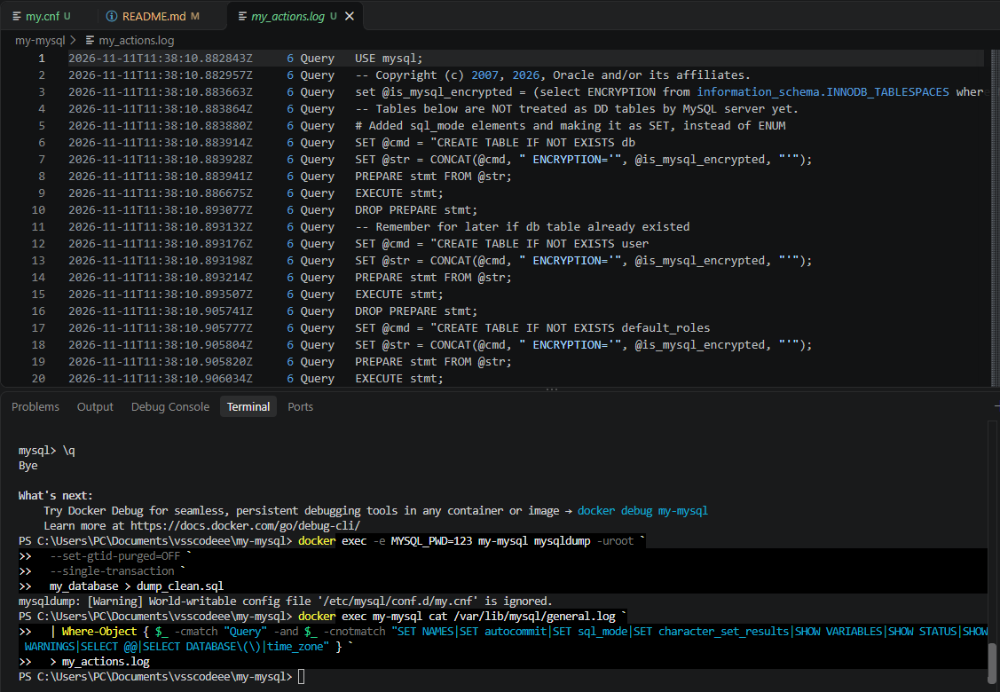

# my-mysql

# Лабораторная работа: Интерактивная работа с MySQL в Docker

## Цель работы
Запуск изолированного контейнера MySQL, выполнение основных операций с БД, создание дампа и выгрузка лога.

## Выполненные шаги
1. Очищены старые контейнеры и тома.

2. Контейнер запущен командой с прямым указанием параметров лога (для обхода проблемы с правами доступа к my.cnf на Windows).

3. Выполнены SQL-запросы: создание БД `my_database`, таблицы `users`, вставка, обновление и удаление данных.

4. Создан дамп базы данных (`dump_clean.sql`).

5. Выгружен лог действий (`my_actions.log`).

## Результаты
В папке проекта находятся:
- `dump_clean.sql` — резервная копия базы данных.
- `my_actions.log` — лог выполненных SQL-запросов.

